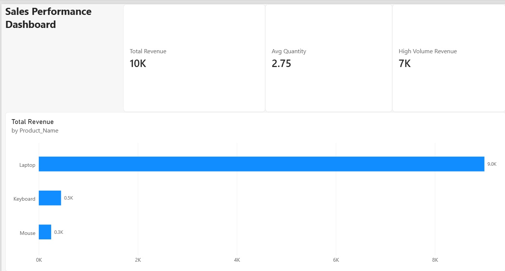

# PowerBI-Sales-Analytics
Interactive Power BI Sales Dashboard built using DAX measures (SUMX, CALCULATE, RELATED) and multi-table data modeling.
# 📊 Power BI Sales Performance Dashboard

## 📌 Project Overview
An executive summary sales dashboard built in Power BI Desktop to analyze total revenue, average order quantities, and high-volume transaction metrics using multi-table data modeling.

## 🛠️ Tech Stack & Concepts Applied
- **Tool:** Power BI Desktop
- **Data Modeling:** 1-to-Many Relationship between Products and Sales tables
- **DAX Measures:**
  - `Total Revenue` = `SUMX(Sheet2, Sheet2[Quantity] * RELATED(Sheet1[Unit_Price]))`
  - `Avg Quantity` = `AVERAGE(Sheet2[Quantity])`
  - `High Volume Revenue` = `CALCULATE([Total Revenue], Sheet2[Quantity] >= 2)`

## 💡 Key Business Insights
- Identified top revenue-generating products using clustered bar visualizations.
- Tracked overall sales KPIs with clear executive card layouts.
